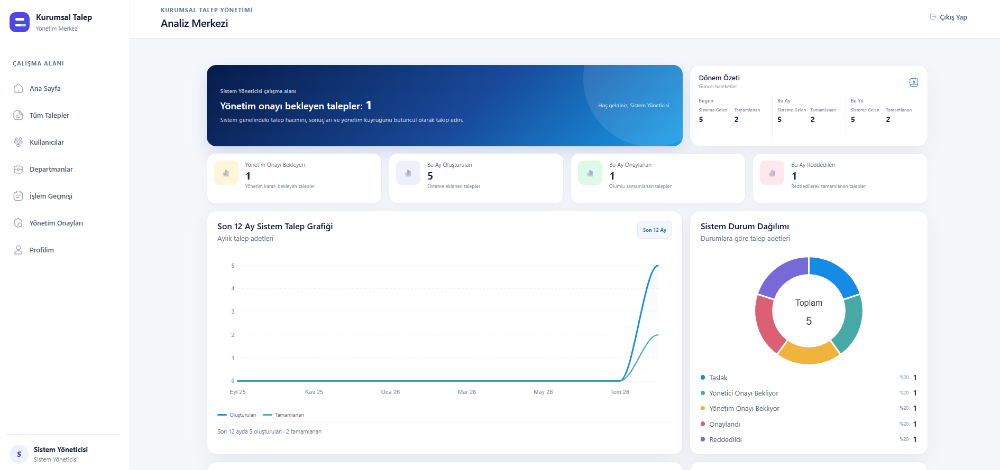
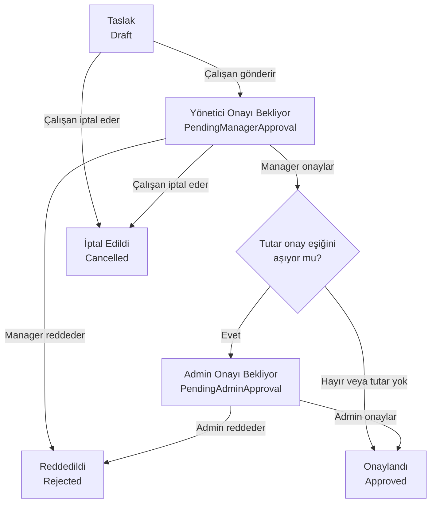
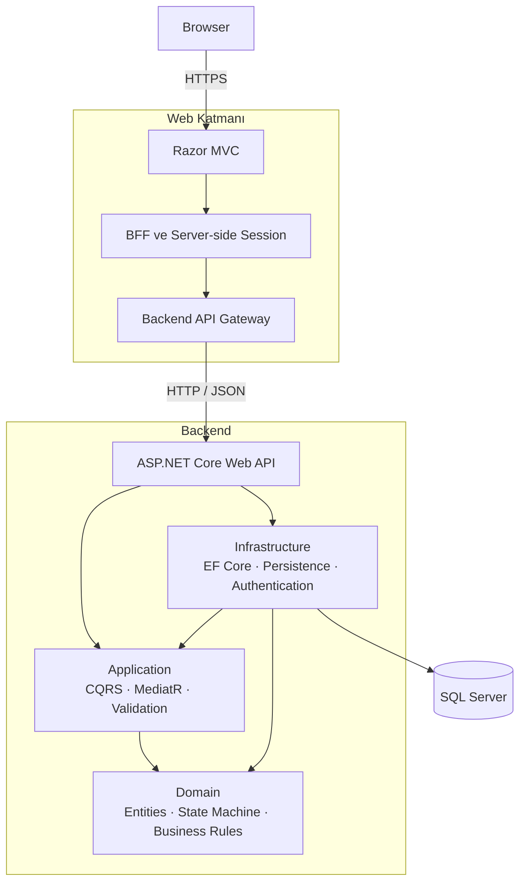
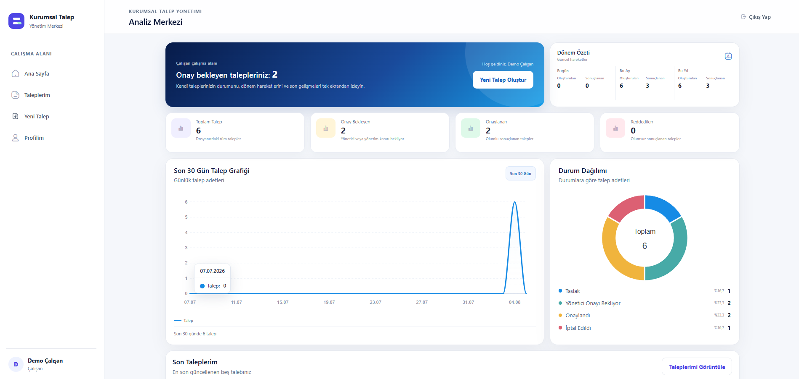
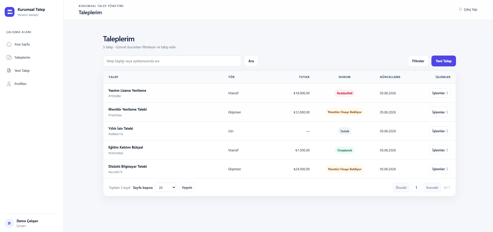
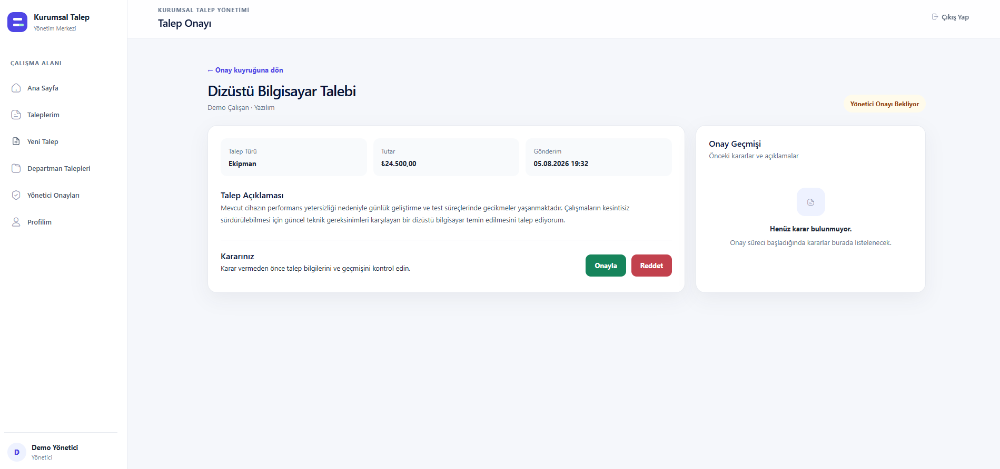
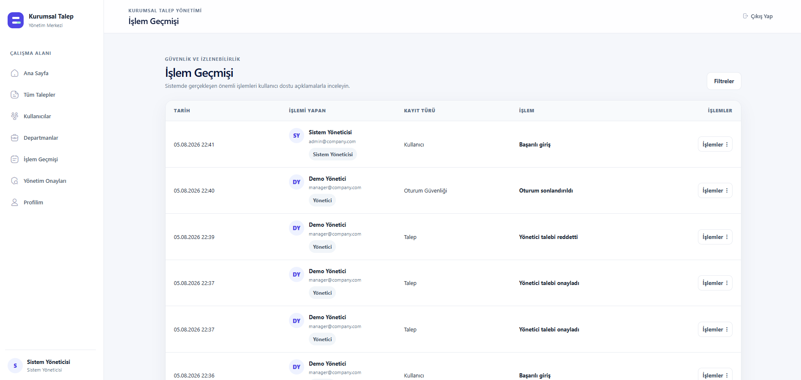
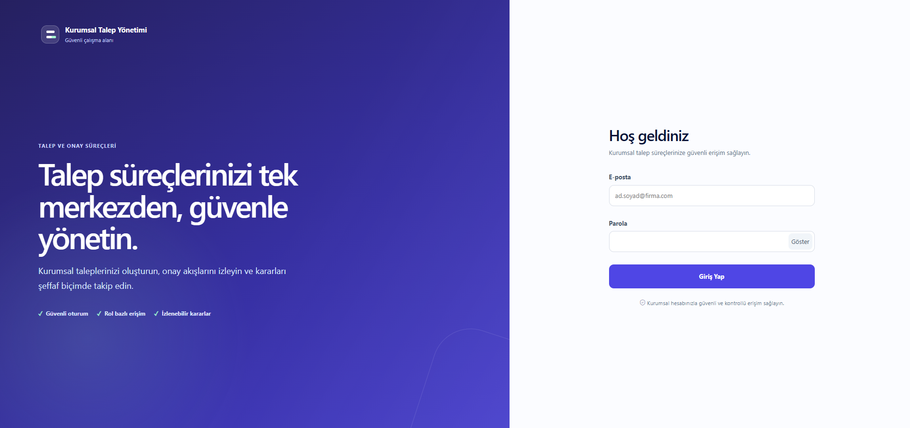

# Kurumsal Talep ve Onay Yönetim Sistemi

Kurumsal taleplerin oluşturulması, departman yöneticisi ve yönetim
onaylarından geçirilmesi, denetlenmesi ve raporlanması için geliştirilen
rol tabanlı bir .NET 8 uygulamasıdır.

Uygulama; Clean Architecture, CQRS/MediatR, SQL Server, JWT refresh-token
rotation, audit logging, optimistic concurrency ve güvenli Razor BFF
yaklaşımını kullanır.

<p align="center">
  
  
  
  
  
</p>


<p align="center">
  
</p>


## Proje özeti

Sistem, çalışan taleplerinin e-posta, mesajlaşma veya kontrolsüz belgeler
üzerinden takip edilmesi yerine merkezi ve denetlenebilir bir süreç sunar.

- Çalışanlar kendi taleplerini oluşturur, düzenler, gönderir ve takip eder.
- Departman yöneticileri yalnızca yetkili oldukları departmanın taleplerini
  değerlendirir.
- Belirlenen tutar eşiğini aşan talepler ikinci seviye Admin onayına aktarılır.
- Kullanıcı, departman, talep ve işlem geçmişi merkezi yönetim ekranlarından
  kontrol edilir.
- Kritik işlemler concurrency kontrolü ve hassas verileri redakte edilmiş
  audit kayıtlarıyla korunur.

## Temel özellikler

- Employee, Manager ve Admin için rol bazlı yetkilendirme
- Tutar eşiğine bağlı iki seviyeli talep onay akışı
- Talep oluşturma, güncelleme, gönderme, iptal ve soft-delete süreçleri
- Kullanıcı ve departman yönetimi
- Manager atama ve doğrudan yönetici oluşturma akışı
- JWT access token ve hashlenmiş refresh-token rotation/revoke
- Güvenli sunucu tarafı Razor BFF ve `HttpOnly` cookie yaklaşımı
- SQL Server `RowVersion` ile optimistic concurrency
- Transactional audit logging ve hassas veri redaksiyonu
- Sunucu tarafı filtreleme, sıralama ve pagination
- Idempotent Development migration ve seed otomasyonu
- Unit testleri ve gerçek SQL Server integration testleri

## Roller ve sorumluluklar

| Rol | Temel sorumluluklar |
|---|---|
| **Employee** | Kendi taleplerini oluşturur, günceller, gönderir, iptal eder ve takip eder. |
| **Manager** | Kendi taleplerini yönetir; yetkili olduğu departmanın taleplerini inceler ve ilk seviye onay veya ret kararı verir. |
| **Admin** | İkinci seviye onayları yürütür; kullanıcıları, departmanları, talepleri ve audit kayıtlarını yönetir. |

> Yetkilendirme yalnızca arayüz görünürlüğüne dayanmaz. API; rolü, kaynak
> sahipliğini ve `Department.ManagerId` ilişkisini her yetkili istekte yeniden
> doğrular. Manager kendi talebi üzerinde onay veya ret kararı veremez.

## Talep yaşam döngüsü



Varsayılan ikinci seviye onay eşiği **10.000 TL**’dir ve yapılandırma
üzerinden değiştirilebilir. Eşiğe eşit veya eşikten düşük talepler Manager
onayıyla tamamlanır; eşiği aşan talepler Admin onayına aktarılır.

`Expense` ve `Equipment` taleplerinde tutar zorunludur. `Leave` ve `Other`
taleplerinde tutar bulunmayabilir. Tamamlanan kararlar approval history ve
hassas veri içermeyen audit kayıtlarıyla korunur.

### Talep türlerinin modellenmesi

`RequestType`; `Expense`, `Equipment`, `Leave` ve `Other` değerlerinden oluşan
bir enum olarak modellenmiştir. Bu değer kümesi sınırlı, önceden tanımlı ve
çalışma zamanında Admin tarafından yönetilmeyen bir domain sözleşmesidir. Enum
kullanımı type-safe iş kuralları ve merkezi validation sağlar; dinamik olarak
yönetilebilir bir talep türü kataloğu gerekseydi reference table tercih
edilirdi.

## Mimari



### Mimari kararlar

- `Domain` katmanı framework ve persistence bağımlılığı taşımaz.
- `Application`, CQRS use-case’lerini, validation kurallarını ve abstraction
  sözleşmelerini içerir.
- `Infrastructure`, persistence ve security abstraction’larını EF Core ve SQL
  Server ile uygular.
- `Api`, authentication, authorization, rate limiting ve HTTP sözleşmelerinin
  giriş noktasıdır.
- `Web`, backend projelerine doğrudan referans vermez; API ile yalnızca
  sunucu tarafı HTTP/JSON üzerinden haberleşir.
- Access ve refresh tokenlar tarayıcı depolamasına yazılmaz; Web sunucusundaki
  session sınırında tutulur.

Daha ayrıntılı dependency ve runtime kararları için
[Mimari dokümana](docs/architecture.md) bakın.

## Proje yapısı

```text
CorporateRequestManagement
├── src
│   ├── CorporateRequestManagement.Domain
│   ├── CorporateRequestManagement.Application
│   ├── CorporateRequestManagement.Infrastructure
│   ├── CorporateRequestManagement.Api
│   └── CorporateRequestManagement.Web
├── tests
│   ├── CorporateRequestManagement.UnitTests
│   └── CorporateRequestManagement.IntegrationTests
├── scripts
│   ├── setup-development.ps1
│   ├── run-development.ps1
│   ├── stop-development.ps1
│   └── test.ps1
└── docs
    ├── api
    ├── screenshots
    ├── architecture.md
    ├── er-diagram.md
    ├── third-party-notices.md
    └── troubleshooting.md
```

| Proje | Sorumluluk |
|---|---|
| `Domain` | Entity, enum, state transition ve temel iş kuralları |
| `Application` | CQRS handler’ları, validation ve abstraction sözleşmeleri |
| `Infrastructure` | EF Core, SQL Server, authentication ve repository uygulamaları |
| `Api` | REST uçları, authorization, rate limiting ve composition root |
| `Web` | Server-rendered Razor MVC arayüzü ve güvenli BFF |
| `UnitTests` | Domain ve Application davranış testleri |
| `IntegrationTests` | API, SQL Server, security ve uçtan uca entegrasyon testleri |

## Hızlı başlangıç

### Ön koşullar

- Git
- .NET 8 SDK
- Windows PowerShell 5.1 veya PowerShell 7
- HTTPS development certificate
- Service-based SQL Server erişimi
- Veritabanı oluşturma yetkisi (`CREATE ANY DATABASE` veya eşdeğer yetki)

> Entegrasyon testleri gerçek SQL Server üzerinde çalışır. LocalDB,
> entegrasyon testleri için desteklenmez.

### 1. Repository’yi klonlayın

```powershell
git clone https://github.com/yigitucaroglu/CorporateRequestManagement.git
cd CorporateRequestManagement
```

Repository private ise klonlama işleminden önce GitHub hesabınıza erişim
verilmiş olmalıdır.

### 2. Development ortamını hazırlayın

```powershell
powershell.exe `
  -NoProfile `
  -ExecutionPolicy Bypass `
  -File .\scripts\setup-development.ps1
```

Setup scripti:

- .NET ve SQL Server ön koşullarını doğrular.
- SQL bağlantı bilgilerini güvenli biçimde alır.
- Connection string ve JWT signing key değerlerini .NET User Secrets içinde
  saklar.
- Secret değerlerini terminale veya repository dosyalarına yazmaz.
- NuGet paketlerini ve local .NET araçlarını restore eder.
- Release build çalıştırır.
- Migration ve Development seed işlemini idempotent olarak uygular.
- Demo kullanıcılarını ve departman kayıtlarını doğrular.

Kurulum aynı veritabanı üzerinde tekrar çalıştırılabilir. Mevcut migration,
kullanıcı veya departman kayıtlarını gereksiz yere çoğaltmaz.

Connection string komut satırına veya bir repository dosyasına yazılmaz;
setup tarafından API ve integration test projelerinin .NET User Secrets
alanlarına aktarılır. Manuel migration uygulaması gereken ileri seviye bir
Development senaryosunda önce aynı secret configuration sağlandıktan sonra:

```powershell
dotnet tool restore
dotnet ef database update `
  --project .\src\CorporateRequestManagement.Infrastructure `
  --startup-project .\src\CorporateRequestManagement.Api
```

Development veritabanını migration ve seed ile başlatan uygulama girişi de
yalnız Development ortamında kullanılabilir:

```powershell
dotnet run `
  --project .\src\CorporateRequestManagement.Api `
  -- --initialize-database
```

Production ortamında bu giriş reddedilir ve demo seed çalıştırılmaz.

### 3. Uygulamayı başlatın

```powershell
powershell.exe `
  -NoProfile `
  -ExecutionPolicy Bypass `
  -File .\scripts\run-development.ps1
```

Script önce API uygulamasını başlatır ve readiness kontrolünü bekler. API hazır
olduktan sonra Web uygulamasını başlatır.

| Uygulama | Adres |
|---|---|
| Web uygulaması | `https://localhost:7002` |
| API Swagger | `https://localhost:7001/swagger` |

Tarayıcının otomatik açılmasını engellemek için:

```powershell
powershell.exe `
  -NoProfile `
  -ExecutionPolicy Bypass `
  -File .\scripts\run-development.ps1 `
  -NoBrowser
```

### 4. Uygulamayı durdurun

```powershell
powershell.exe `
  -NoProfile `
  -ExecutionPolicy Bypass `
  -File .\scripts\stop-development.ps1
```

Stop scripti yalnızca bu repository’ye ait olduğu doğrulanan API ve Web process
tree’lerini kapatır. Makinedeki diğer `dotnet` processlerine müdahale etmez.

### 5. Kalite kapılarını çalıştırın

```powershell
powershell.exe `
  -NoProfile `
  -ExecutionPolicy Bypass `
  -File .\scripts\test.ps1
```

Test scripti sırasıyla:

1. SQL Server bağlantı ön kontrolünü,
2. restore işlemlerini,
3. Release build’i,
4. unit testlerini,
5. integration testlerini,
6. EF Core migration drift kontrolünü

çalıştırır.

Entegrasyon testleri her koşuda yalnızca kendilerine ait,
`CorporateRequestManagement_IntegrationTests_` önekli geçici bir SQL Server
veritabanı oluşturur ve işlem sonunda yalnızca bu veritabanını kaldırır.

Kurulum veya çalıştırma sorunları için
[Sorun giderme rehberine](docs/troubleshooting.md) bakın.

## Development hesapları

> **Yalnızca Development ortamı içindir.** Aşağıdaki hesaplar Production,
> paylaşılan test veya internete açık ortamlarda kullanılmamalıdır.
> Production başlangıcında otomatik olarak oluşturulmazlar.

| Rol | E-posta | Parola |
|---|---|---|
| Admin | `admin@company.com` | `CrmDemo!2026` |
| Manager | `manager@company.com` | `CrmDemo!2026` |
| Employee | `employee@company.com` | `CrmDemo!2026` |

Development seed ayrıca `Yazılım` ve `Finans` departmanlarını oluşturur.
Manager ve Employee, `Yazılım` departmanına bağlanır ve departman yöneticisi
ilişkisi tutarlı biçimde kurulur.

Parolalar veritabanında düz metin olarak saklanmaz; ASP.NET Core password
hasher çıktısı kullanılır.

## Kalite doğrulaması

Son izole clean-clone teslim doğrulamasında repository yeni bir klasöre
klonlanmış; setup, migration, seed, API/Web başlangıcı, üç rolün giriş akışı,
testler, güvenli durdurma ve cleanup işlemleri sıfırdan doğrulanmıştır.

| Kalite kapısı | Sonuç |
|---|---:|
| Release build | 0 warning, 0 error |
| Unit testleri | 260 passed |
| Integration testleri | 235 passed |
| Toplam | 495 passed |
| Failed | 0 |
| Skipped | 0 |
| Migration drift | Temiz |
| Clean-clone setup | Başarılı |
| Development seed idempotency | Başarılı |
| Üç rol ile login | Başarılı |
| API/Web readiness | Başarılı |

> Bu tablo Ağustos 2026 tarihindeki son teslim doğrulamasını gösterir. Test
> kapsamı değiştirildiğinde sonuçlar yeniden çalıştırılmalıdır.
>
> Source build ve testlerinde hata yoktur. NuGet vulnerability audit servisine
> ağ erişilemeyen ortamlarda `NU1900` görülebilir; bu uyarı restore veya test
> sonucunu etkilemez.

## Güvenlik yaklaşımı

Uygulamanın güvenlik modeli yalnızca arayüzde buton veya menü gizlemeye
dayanmaz. Yetkilendirme ve kaynak erişimi API katmanında yeniden doğrulanır.

- Access ve refresh token değerleri tarayıcı `localStorage` veya
  `sessionStorage` alanlarına yazılmaz.
- Tarayıcı yalnızca opaque ve `HttpOnly` authentication/session cookie’lerini
  taşır.
- Access ve refresh tokenlar Web sunucusundaki server-side session sınırında
  tutulur.
- Refresh tokenların veritabanında yalnızca SHA-256 özeti saklanır.
- Token rotation ve revoke akışları uygulanır.
- Web form mutation işlemleri antiforgery koruması kullanır.
- API; rol, kaynak sahipliği ve authoritative departman yöneticisi ilişkisini
  kontrol eder.
- Manager kendi talebi üzerinde onay veya ret kararı veremez.
- SQL Server `RowVersion` ile optimistic concurrency uygulanır.
- Kritik işlemler transaction sınırında yürütülür.
- Audit kayıtlarında hassas payload değerleri redakte edilir.
- Authentication ve genel API çağrıları rate limiting ile sınırlandırılır.
- API transport hataları teknik ayrıntı sızdırmadan güvenli `503` veya `504`
  kullanıcı sonuçlarına çevrilir.
- Connection string ve JWT signing key repository yerine .NET User Secrets
  veya environment configuration üzerinden sağlanır.

### Access ve refresh token yaşam döngüsü

1. Başarılı login, **15 dakika** ömürlü JWT access token ve **7 gün** ömürlü
   rastgele refresh token üretir.
2. Ham refresh token istemciye yalnız token response içinde verilir;
   veritabanında yalnız SHA-256 hash'i, oluşturma IP'si ve süre bilgileri
   saklanır.
3. Refresh çağrısı eski tokenı atomik olarak revoke eder, yerine bağlı yeni
   bir refresh token ve access token üretir. Kullanılmış, süresi dolmuş,
   revoke edilmiş veya geçersiz token tekrar kullanılamaz.
4. Revoke/logout akışı aktif refresh tokenı geçersizleştirir. Parola veya
   hesap durumundaki kritik değişiklikler de kullanıcı tokenlarını revoke
   eder.

Web uygulaması ham tokenları browser storage'a koymaz; server-side session
sınırında tutar ve tarayıcıya yalnız `HttpOnly` session cookie'si verir.

### Rate limiting

- Login, refresh ve revoke gibi auth uçları remote IP başına sabit **60
  saniyelik pencerede 5** istekle sınırlıdır. Bu daha sıkı sınır brute-force
  ve token abuse riskini azaltır.
- Genel API limiti authenticated kullanıcı kimliği, bu yoksa remote IP başına
  sabit **60 saniyelik pencerede 100** istektir; normal UI kullanımına daha
  geniş kapasite tanır.
- Her iki limiter için kuyruk kapasitesi `0`'dır. Limit aşımında API güvenli
  ProblemDetails gövdesiyle HTTP **429** döndürür.

### CQRS ve MediatR yerleşimi

```text
src/CorporateRequestManagement.Application
├── Features/Authentication/{Login,Refresh,Revoke}
├── Features/CorporateRequests/{Create,UpdateDraft,Submit,Cancel,GetMine,GetById}
├── Features/Approvals/{Decisions,Queries}
└── Features/Administration/AdministrationUseCases.cs
```

Command handler'ları domain davranışını, odaklı repository'leri ve transaction
sınırını koordine eder. Query handler'ları dedicated read service üzerinden
`AsNoTracking`, filtreleme ve DTO projection kullanır. Admin use-case'leri de
aynı ayrımı izler; controller'lar yalnız HTTP input/output ve MediatR çağrısı
yapar.

### Soft delete

`User`, `Department` ve `CorporateRequest` fiziksel olarak silinmez. Silme
işlemi `IsDeleted`, silen kullanıcı ve UTC silinme zamanını kaydeder; EF Core
global query filter normal list/detail sorgularında bu kayıtları dışlar.
Approval ve audit geçmişi korunur. Yetkili admin işlemleri dahil aktiflik,
ilişki ve silinme durumu API tarafında yeniden doğrulanır.

## Uygulama ekranları

| Employee dashboard | Taleplerim |
|---|---|
|  |  |

| Manager onay akışı | İşlem geçmişi |
|---|---|
|  |  |

| Giriş | Admin dashboard |
|---|---|
|  |  |

## Dokümantasyon

| Belge | İçerik |
|---|---|
| [Mimari](docs/architecture.md) | Katman sınırları, dependency yönü ve runtime kararları |
| [ER diyagramı](docs/er-diagram.md) | Entity, alan ve ilişkilerin veri modeli |
| [API örnekleri](docs/api/) | Authentication, talepler, onaylar ve yönetim uçları için `.http` örnekleri |
| [Sorun giderme](docs/troubleshooting.md) | SQL Server, User Secrets, port, HTTPS ve process sorunları |
| [Third-party bildirimleri](docs/third-party-notices.md) | Framework, paket ve UI template bildirimleri |

## Bilinen sınırlamalar

- Web uygulamasının server-side session store’u mevcut değerlendirme
  senaryosunda memory-backed ve tek-node çalışacak şekilde yapılandırılmıştır.
- Çoklu instance Production dağıtımında distributed session store ve ortak
  Data Protection key ring kullanılmalıdır.
- Development otomasyonları Windows PowerShell 5.1 üzerinde gerçek ortamda
  doğrulanmıştır.
- Integration testleri LocalDB yerine veritabanı oluşturma yetkisine sahip
  service-based SQL Server gerektirir.
- Repository production deployment pipeline, container orchestration veya
  distributed caching altyapısı sağlamaz.
- Production secret yönetiminde Development User Secrets yerine kurumun
  merkezi secret yönetim çözümü kullanılmalıdır.
- Mevcut değerlendirme doğrudan Kestrel kullanımını varsayar. Reverse proxy
  kullanılan Production dağıtımında ASP.NET Core Forwarded Headers yalnızca
  güvenilir proxy/network allow-list’iyle yapılandırılmalı; güvenilmeyen
  forwarded header değerleri doğrudan kabul edilmemelidir.

Bu sınırlamalar temel talep ve onay akışlarını etkilemez; production ölçekleme
ve operasyon gereksinimleri için ilave altyapı kararları gerektirir.

## UI template ve third-party bildirimleri

Web arayüzünde Metronic/KeenThemes tabanlı lisanslı runtime assetleri
kullanılmaktadır. Repository’ye yalnızca uygulamanın çalışması için gereken
derlenmiş CSS, JavaScript, font ve görsel alt kümesi dahil edilmiştir.

- Tema kaynak arşivleri repository içinde bulunmaz.
- Demo sayfaları ve kaynak build paketleri dahil edilmez.
- Ticari assetler bu repository tarafından açık kaynak olarak yeniden
  lisanslanmaz.
- İlgili marka, asset ve lisans hakları kendi hak sahiplerine aittir.
- Ayrıntılı bildirimler
  [third-party notices](docs/third-party-notices.md) belgesinde yer alır.


