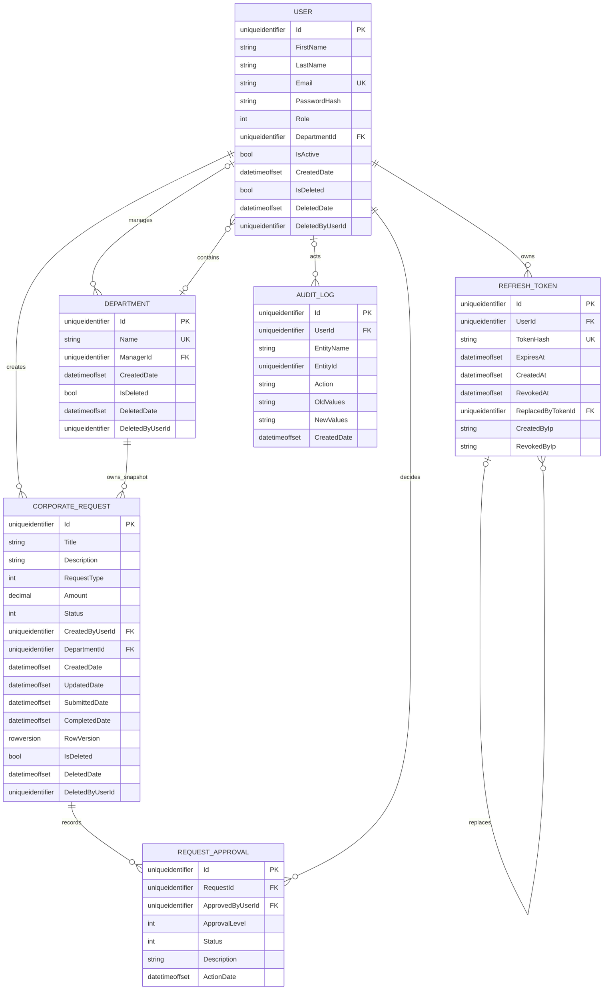

# ER Diyagramı

GitHub bu Mermaid bloğunu görsel ER diyagramı olarak render eder.

User, Department ve CorporateRequest fiziksel silinmez; global query filter normal sorgularda `IsDeleted=true` kayıtları dışlar. RequestApproval ve AuditLog tarihçe olarak korunur. `CorporateRequest.RowVersion` SQL Server optimistic concurrency token’ıdır.
